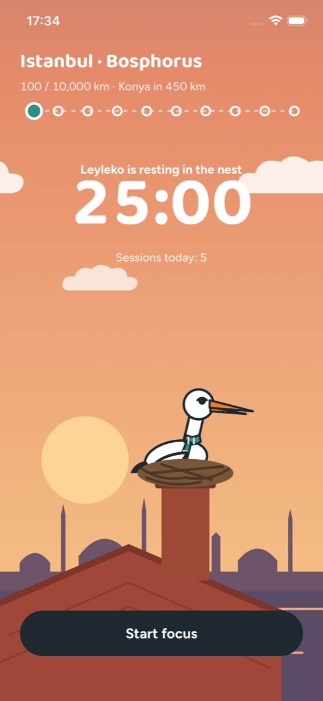

# Stork

A Pomodoro app where breaks have a job: walk. Focus for 25 minutes while Leyleko the stork waits in its nest on a chimney above Istanbul, then walk during the 5-minute break. Every step flies Leyleko further along its migration to Cape Town.

<p align="center">
  
</p>

## Run

```bash
npm install
npx expo start
```

- **iOS:** step counting works in Expo Go.
- **Android:** Expo Go lacks the activity-recognition permission, so use a development build: `npx expo run:android`.
- **Lock screen Live Activity:** needs a native build (`npx expo run:ios`, Xcode 26.4+). Expo Go runs the app without it.

In development builds a "Skip (dev)" link fast-forwards the timer.

## How it works

- `App.tsx` handles the focus, break, and result phases. The timer counts down to a fixed end timestamp, so it stays correct after backgrounding.
- `src/Scene.tsx` draws the skyline, chimney nest and clouds; `src/theme.ts` picks the sky for the time of day.
- `src/StorkView.tsx` is Leyleko, a layered SVG puppet that blinks, flaps and clatters its beak.
- `src/JourneyBar.tsx` shows the flight path; `src/route.ts` lists the migration stops.
- `src/SessionActivity.tsx` and `src/liveSession.ts` drive the lock screen Live Activity.
- `src/storage.ts` saves progress locally with AsyncStorage.
- A break counts if you take at least 50 steps. Each step is 1 km of flight; a desk stretch is worth 100 km.
